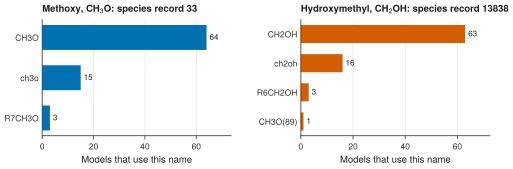

# 1. Find a species by its structure

**Question.** Methoxy (CH<sub>3</sub>O) and hydroxymethyl (CH<sub>2</sub>OH) have the same formula. Which species record is each radical, and which names do the kinetic models use for it?

## How the API answers the question

1. **Request**

    ```bash
    curl "https://pr.omethe.us/api/species/?inchi=1S/CH3O/c1-2/h1H3&has_electronic_state=false"
    ```

    **Response:** One species record, 33, which is methoxy. The `inchi` filter compares the whole InChI, so hydroxymethyl, which has a different InChI, is not in the response. `has_electronic_state=false` leaves out excited states.

2. **Request**

    ```bash
    curl "https://pr.omethe.us/api/kineticmodel/?species=33&fields=id,model_name,speciesname_set"
    ```

    **Response:** Each model that contains methoxy. In `speciesname_set`, each name of the model links to a species record. The names that link to record 33 are the names of methoxy in that model.

3. **Request**

    ```bash
    curl "https://pr.omethe.us/api/species/?inchi=1S/CH3O/c1-2/h2H,1H2&has_electronic_state=false"
    ```

    **Response:** One species record, 13838, which is hydroxymethyl. The request of step 2 with `species=13838` gives its models.

## Code

[Download uc01_species_by_structure.py](code/uc01_species_by_structure.py). The script imports [prometheus_api.py](code/prometheus_api.py); put it in the same folder (see [Running the scripts](index.md#running-the-scripts)). A line `# %%` starts each cell, so an editor such as VS Code or Jupyter can run the script one cell at a time.

**1. Imports**

```python
--8<-- "code/uc01_species_by_structure.py:4:8"
```

**2. Find the species record of each radical from its structure (InChI)**

```python
--8<-- "code/uc01_species_by_structure.py:11:12"
```

**3. Count the names that the models use for each species record**

```python
--8<-- "code/uc01_species_by_structure.py:15:19"
```

**4. Plot the names of each species record**

```python
--8<-- "code/uc01_species_by_structure.py:22:33"
```

## Result

```text
--8<-- "output/uc01_species_by_structure.txt"
```

## Plot



## What the result shows

- The models use three names for methoxy and four names for hydroxymethyl.
- One model, AutoTST-OOHabstraction, names hydroxymethyl `CH3O(89)`. A program that finds a species by its name would take this species for methoxy. A program that uses the species record gets the right radical, because the species record gives the structure.
