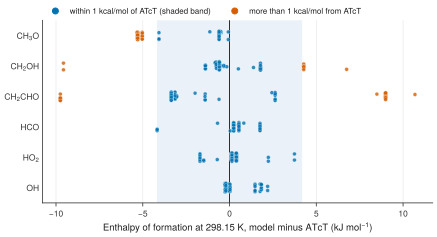

# 2. Compare the enthalpy of formation with ATcT

**Question.** Which kinetic models use an enthalpy of formation that differs from the Active Thermochemical Tables (ATcT), and by how much?

## How the API answers the question

1. **Request**

    ```bash
    curl "https://pr.omethe.us/api/species/?inchi=1S/CH3O/c1-2/h1H3&has_electronic_state=false"
    ```

    **Response:** The species record of CH<sub>3</sub>O, 33 (see use case 1).

2. **Request**

    ```bash
    curl "https://pr.omethe.us/api/thermo/?species=33&reference=false"
    ```

    **Response:** The thermochemistry entries of the models for CH<sub>3</sub>O. Each entry gives two NASA polynomials. `reference=false` leaves out the polynomials that the database fitted to reference data.

3. **Request**

    ```bash
    curl "https://pr.omethe.us/api/kineticmodel/?species=33&fields=id,model_name,thermocomment_set"
    ```

    **Response:** The links of each model to thermochemistry entries. The link to one of the entries of the previous request is the CH<sub>3</sub>O entry of that model.

4. **Request**

    ```bash
    curl "https://pr.omethe.us/api/thermo-record/?provider=atct&species=33"
    ```

    **Response:** The ATcT value: `enthalpy_298` and its uncertainty `uncertainty_298`, in J/mol.

From the low-temperature polynomial of each entry, the script calculates the enthalpy of formation at 298.15 K (`h_kj` in `chem_tools.py`). It repeats the steps for five other species.

## Code

[Download uc02_enthalpy_vs_atct.py](code/uc02_enthalpy_vs_atct.py). The script imports [prometheus_api.py](code/prometheus_api.py) and [chem_tools.py](code/chem_tools.py); put them in the same folder (see [Running the scripts](index.md#running-the-scripts)). A line `# %%` starts each cell, so an editor such as VS Code or Jupyter can run the script one cell at a time.

**1. Imports**

```python
--8<-- "code/uc02_enthalpy_vs_atct.py:4:12"
```

**2. For each species: the entries of the models, the entry that each model uses, and ATcT**

```python
--8<-- "code/uc02_enthalpy_vs_atct.py:15:24"
```

**3. Plot each model value minus ATcT**

```python
--8<-- "code/uc02_enthalpy_vs_atct.py:27:40"
```

## Result

```text
--8<-- "output/uc02_enthalpy_vs_atct.txt"
```

## Plot



## What the result shows

- For CH<sub>3</sub>O, many models give a value more than 1 kcal/mol (4.184 kJ/mol) below ATcT. These models use the older values 16.3 and 16.6 kJ/mol.
- For HCO, HO<sub>2</sub> and OH, the value of each model is within 1 kcal/mol of ATcT.
- The models use far fewer thermochemistry entries than there are models. When two models give identical polynomials, the database stores one entry, so these models have identical data.
