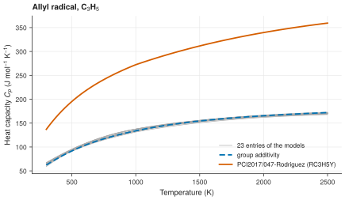

# 3. Compare the heat capacity of one species

**Question.** How much does the heat capacity of the allyl radical (C<sub>3</sub>H<sub>5</sub>) differ between the kinetic models, and from a group-additivity estimate?

## How the API answers the question

1. **Request**

    ```bash
    curl "https://pr.omethe.us/api/thermo/?species=13848&reference=false"
    ```

    **Response:** The thermochemistry entries of the models for allyl (species record 13848). Each entry is one set of NASA polynomials. `reference=false` leaves out the entries that belong to a reference record.

2. **Request**

    ```bash
    curl "https://pr.omethe.us/api/thermo-record/?species=13848&provider=group_additivity"
    ```

    **Response:** The reference record of allyl from group additivity, 144. A reference record gives the values of one outside source: the enthalpy of formation, the entropy, the version and the provenance. Its field `nasa_thermo` gives the ID of its NASA polynomials in `/api/thermo/`, here 9292.

3. **Request**

    ```bash
    curl "https://pr.omethe.us/api/thermo/9292/"
    ```

    **Response:** The NASA polynomials of the group-additivity record. Its field `provider_record` points back to record 144.

4. **Request**

    ```bash
    curl "https://pr.omethe.us/api/kineticmodel/?species=13848&fields=id,model_name,thermocomment_set,speciesname_set"
    ```

    **Response:** The models that use each entry, and the name that each model uses for allyl.

## Code

[Download uc03_heat_capacity.py](code/uc03_heat_capacity.py). The script imports [prometheus_api.py](code/prometheus_api.py) and [chem_tools.py](code/chem_tools.py); put them in the same folder (see [Running the scripts](index.md#running-the-scripts)). A line `# %%` starts each cell, so an editor such as VS Code or Jupyter can run the script one cell at a time.

**1. Imports**

```python
--8<-- "code/uc03_heat_capacity.py:4:10"
```

**2. The thermochemistry entries of the models (reference=false leaves out the reference records)**

```python
--8<-- "code/uc03_heat_capacity.py:13:14"
```

**3. The group-additivity reference record, and its NASA polynomials (field nasa_thermo)**

```python
--8<-- "code/uc03_heat_capacity.py:17:20"
```

**4. Find the entries whose heat capacity is far from the others, and the models that use them**

```python
--8<-- "code/uc03_heat_capacity.py:23:31"
```

**5. Plot the heat capacity of each entry**

```python
--8<-- "code/uc03_heat_capacity.py:34:47"
```

## Result

```text
--8<-- "output/uc03_heat_capacity.txt"
```

## Plot



## What the result shows

- The entries of almost all the models give nearly the same heat capacity as the group-additivity estimate.
- One entry gives about twice this heat capacity, and an enthalpy of formation of −282 kJ/mol. The enthalpy of formation of allyl is near +170 kJ/mol. This entry is in the model PCI2017/047-Rodriguez, which names allyl `RC3H5Y`.
- The CHEMKIN file that the authors of PCI2017/047-Rodriguez published gives these coefficients for `RC3H5Y`. Thus the error is in the published model, and the API gives the model as its authors published it. The same file gives identical coefficients to three other radicals (use case 4).

!!! note
    `/api/thermo/?species=13848&reference=true` gives the NASA polynomials of all the reference records of allyl, from every provider. To know the provider of one of these entries, follow its `provider_record` to `/api/thermo-record/`. An ATcT record gives only enthalpies, so it has no NASA polynomials (`nasa_thermo` is null).
