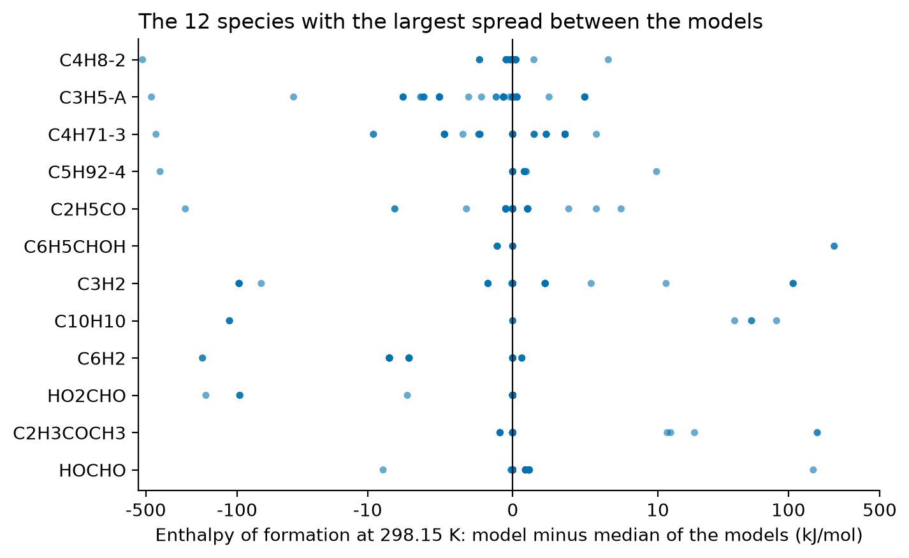

# 4. Find the species that models disagree on

**Question.** For which species do the kinetic models disagree most on the enthalpy of formation?

## How the API answers the question

1. **Request**

    ```bash
    curl "https://pr.omethe.us/api/thermo/?reference=false&page_size=1000"
    ```

    **Response:** All the thermochemistry entries of the models, in pages of 1,000 (about 20 requests).

2. **Request**

    ```bash
    curl "https://pr.omethe.us/api/kineticmodel/?fields=id,model_name,thermocomment_set,speciesname_set&page_size=1000"
    ```

    **Response:** For each model: its links to thermochemistry entries, and its species names. The names give the labels of the plot.

For each species in ten or more models, the script calculates the enthalpy of formation of each model, and the spread: the largest value minus the smallest value.

## Code

[Download uc04_enthalpy_spread.py](code/uc04_enthalpy_spread.py). The script needs the two [helper files](index.md#running-the-scripts).

```python
--8<-- "code/uc04_enthalpy_spread.py"
```

## Result

```text
--8<-- "output/uc04_enthalpy_spread.txt"
```

## Plot



## What the result shows

- For most species in ten or more models, the values of the models spread over more than 1 kcal/mol.
- The value −282.0 kJ/mol appears for four different radicals: C<sub>3</sub>H<sub>5</sub>-A, C4H71-3, C5H92-4 and C<sub>2</sub>H<sub>5</sub>CO. All four values come from the model PCI2017/047-Rodriguez. The CHEMKIN file that its authors published gives the same NASA polynomials to its radicals `RC3H5Y`, `RC4H7Y`, `RC5H9Y` and `RC3H5O`.
- Thus a comparison of all models finds errors in single models, as well as real differences between the models.

!!! note
    The horizontal axis is logarithmic for differences larger than 10 kJ/mol, so the large differences and the small differences both show.
