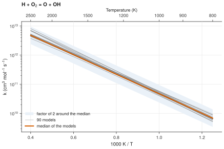

# 5. Compare one rate coefficient in all models

**Question.** Do the kinetic models agree on the rate coefficient of H + O<sub>2</sub> = O + OH?

## How the API answers the question

1. **Request**

    ```bash
    curl "https://pr.omethe.us/api/species/?inchi=1S/O2/c1-2&has_electronic_state=false&multiplicity=3"
    ```

    **Response:** The species record of triplet O<sub>2</sub>. O<sub>2</sub> and O have a singlet and a triplet species record, so `multiplicity=3` selects the ground state. The species records of H and OH come from their InChIs in the same way.

2. **Request**

    ```bash
    curl "https://pr.omethe.us/api/reaction/?species=6&species=8&species=7&species=9"
    ```

    **Response:** The reactions that contain all four species. A repeated `species` parameter selects the records that contain every species given. The script keeps the reaction record whose stoichiometry is exactly H + O<sub>2</sub> = O + OH.

3. **Request**

    ```bash
    curl -G "https://pr.omethe.us/api/kinetics/" --data-urlencode "canonical_key=MYMOFIZGZYHOMD-UHFFFAOYSA-N-3 + YZCKVEUIGOORGS-UHFFFAOYSA-N-2 = QVGXLLKOCUKJST-UHFFFAOYSA-N-3 + TUJKJAMUKRIRHC-UHFFFAOYSA-N-2"
    ```

    **Response:** All the rate records of the reaction, in both directions. The `canonical_key` of the reaction record contains spaces, `+` and `=`, so `--data-urlencode` encodes it.

4. **Request**

    ```bash
    curl "https://pr.omethe.us/api/kineticmodel/?species=6&species=8&species=7&species=9&fields=id,model_name,kineticscomment_set"
    ```

    **Response:** The links of each model to rate records. The links to the rate records of the previous request give the rate coefficient of each model.

The script calculates the rate coefficient of each model at 1 bar (`rate_k` in `chem_tools.py`) and compares it with the median of the models.

## Code

[Download uc05_rate_one_reaction.py](code/uc05_rate_one_reaction.py). The script imports [prometheus_api.py](code/prometheus_api.py) and [chem_tools.py](code/chem_tools.py); put them in the same folder (see [Running the scripts](index.md#running-the-scripts)). A line `# %%` starts each cell, so an editor such as VS Code or Jupyter can run the script one cell at a time.

**1. Imports**

```python
--8<-- "code/uc05_rate_one_reaction.py:3:7"
```

**2. The species records (O2 and O have a singlet and a triplet record: take the triplet)**

```python
--8<-- "code/uc05_rate_one_reaction.py:10:11"
```

**3. The reaction record and all its rate records (in both directions)**

```python
--8<-- "code/uc05_rate_one_reaction.py:14:15"
```

**4. The rate records that each model uses in this direction**

```python
--8<-- "code/uc05_rate_one_reaction.py:18:20"
```

**5. The rate coefficient of each model from 800 to 2500 K, and the median of the models**

```python
--8<-- "code/uc05_rate_one_reaction.py:23:30"
```

**6. Plot the rate coefficients of the models against 1000/T**

```python
--8<-- "code/uc05_rate_one_reaction.py:33:45"
```

## Result

```text
--8<-- "output/uc05_rate_one_reaction.txt"
```

## Plot



## What the result shows

- The rate coefficient of each model is within a factor of 2 of the median, from 800 to 2500 K.
- The models use many different rate records, but these records give nearly the same rate coefficient.

!!! note
    One model gives only the reverse reaction, O + OH = H + O<sub>2</sub>. The script leaves it out. Use case 7 shows how to find these models.

!!! note
    No filter selects the models that use a given rate record. Thus the script gets the links of all the models that contain the four species, which is a large response (about 20 MB).
