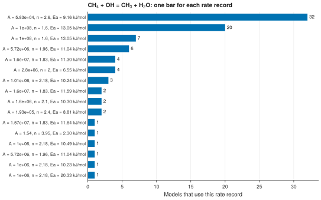

# 6. Find the rate expressions that models share

**Question.** For CH<sub>4</sub> + OH = CH<sub>3</sub> + H<sub>2</sub>O, which rate expressions do the kinetic models share?

## How the API answers the question

1. **Request**

    ```bash
    curl "https://pr.omethe.us/api/reaction/?species=13&species=9&species=15&species=10"
    ```

    **Response:** The reactions that contain CH<sub>4</sub>, OH, CH<sub>3</sub> and H<sub>2</sub>O. The script keeps the reaction record of CH<sub>4</sub> + OH = CH<sub>3</sub> + H<sub>2</sub>O.

2. **Request**

    ```bash
    curl "https://pr.omethe.us/api/kinetics/?reaction=10207"
    ```

    **Response:** The rate records of this reaction record. Each rate record gives one set of rate parameters.

3. **Request**

    ```bash
    curl "https://pr.omethe.us/api/kineticmodel/?species=13&species=9&species=15&species=10&fields=id,model_name,kineticscomment_set"
    ```

    **Response:** The links of each model to rate records. The script counts the models that link to each rate record.

## Code

[Download uc06_shared_rates.py](code/uc06_shared_rates.py). The script imports [prometheus_api.py](code/prometheus_api.py) and [chem_tools.py](code/chem_tools.py); put them in the same folder (see [Running the scripts](index.md#running-the-scripts)). A line `# %%` starts each cell, so an editor such as VS Code or Jupyter can run the script one cell at a time.

**1. Imports**

```python
--8<-- "code/uc06_shared_rates.py:3:6"
```

**2. The reaction record and its rate records (this direction only)**

```python
--8<-- "code/uc06_shared_rates.py:9:12"
```

**3. A rate record is stored once, and each model links to the rate record that it uses**

```python
--8<-- "code/uc06_shared_rates.py:15:17"
```

**4. Print the parameters of the most used rate records (A in cm3/(mol s), Ea in kJ/mol)**

```python
--8<-- "code/uc06_shared_rates.py:20:29"
```

**5. Plot the number of models that use each rate record**

```python
--8<-- "code/uc06_shared_rates.py:32:42"
```

## Result

```text
--8<-- "output/uc06_shared_rates.txt"
```

## Plot



## What the result shows

- A rate record is stored once. Thus the number of models that link to a rate record shows how widely the models share that rate expression.
- Two rate records give A = 1.0 × 10<sup>8</sup> cm<sup>3</sup> mol<sup>−1</sup> s<sup>−1</sup> and n = 1.6, and their activation energies differ by 1 cal/mol (3120 and 3119 cal/mol). The database compares the rate parameters exactly, so it keeps these two records apart.

!!! note
    The labels give the rate parameters in one set of units: A in cm<sup>3</sup> mol<sup>−1</sup> s<sup>−1</sup> and E<sub>a</sub> in kJ/mol. The rate records keep the units of each model, and the fields `a_si` and `e_si` give the SI values.
