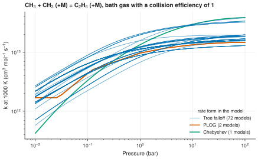

# 7. Compare the pressure dependence of a rate coefficient

**Question.** How does the rate coefficient of CH<sub>3</sub> + CH<sub>3</sub> (+M) = C<sub>2</sub>H<sub>6</sub> (+M) depend on pressure in each kinetic model?

## How the API answers the question

1. **Request**

    ```bash
    curl "https://pr.omethe.us/api/reaction/?species=15&species=13843"
    ```

    **Response:** The reactions that contain CH<sub>3</sub> and C<sub>2</sub>H<sub>6</sub>. The script keeps the record of 2 CH<sub>3</sub> = C<sub>2</sub>H<sub>6</sub>.

2. **Request**

    ```bash
    curl -G "https://pr.omethe.us/api/kinetics/" --data-urlencode "canonical_key=OTMSDBZUPAUEDD-UHFFFAOYSA-N-1 = WCYWZMWISLQXQU-UHFFFAOYSA-N-2 + WCYWZMWISLQXQU-UHFFFAOYSA-N-2"
    ```

    **Response:** The rate records in both directions. `data.type` gives the form of each record: `troe`, `lindemann`, `third_body`, `pdep_arrhenius` (PLOG) or `chebyshev`. `specific_collider` gives the collider of a reaction for one collider only, for example (+AR).

3. **Request**

    ```bash
    curl "https://pr.omethe.us/api/kineticmodel/?species=15&species=13843&fields=id,model_name,kineticscomment_set"
    ```

    **Response:** The links of each model to these rate records.

The script calculates the rate coefficient of each model at 1000 K, from 0.01 to 100 bar, for a bath gas with a collision efficiency of 1. A record for one specific collider does not apply to such a bath gas, so the script leaves it out.

## Code

[Download uc07_pressure_dependence.py](code/uc07_pressure_dependence.py). The script imports [prometheus_api.py](code/prometheus_api.py) and [chem_tools.py](code/chem_tools.py); put them in the same folder (see [Running the scripts](index.md#running-the-scripts)). A line `# %%` starts each cell, so an editor such as VS Code or Jupyter can run the script one cell at a time.

**1. Imports**

```python
--8<-- "code/uc07_pressure_dependence.py:4:11"
```

**2. The reaction record, and its rate records in both directions**

```python
--8<-- "code/uc07_pressure_dependence.py:14:16"
```

**3. Check our rate coefficients against the server's rate_fingerprint (log10 k in SI at 500, 1000, 1500 K)**

```python
--8<-- "code/uc07_pressure_dependence.py:19:22"
```

**4. For each model: the rate records in this direction for a bath gas (no specific_collider)**

```python
--8<-- "code/uc07_pressure_dependence.py:25:34"
```

**5. The rate coefficient at 1000 K from 0.01 to 100 bar, and the rate form of each model**

```python
--8<-- "code/uc07_pressure_dependence.py:37:44"
```

**6. Print the result**

```python
--8<-- "code/uc07_pressure_dependence.py:47:53"
```

**7. Plot k against pressure, one colour for each rate form**

```python
--8<-- "code/uc07_pressure_dependence.py:56:72"
```

## Result

```text
--8<-- "output/uc07_pressure_dependence.txt"
```

## Plot



## What the result shows

- Most models give a Troe falloff expression. Two models give PLOG tables and one gives a Chebyshev expression. The PLOG curves bend at the pressures of their tables, because the rate coefficient is interpolated linearly in log k and log p between them.
- At each pressure, the rate coefficients of the models differ by a factor of 3 to 4.
- Some models give only the reverse reaction, C<sub>2</sub>H<sub>6</sub> (+M) = 2 CH<sub>3</sub> (+M). To compare them, convert their rate coefficient with the equilibrium constant from the thermochemistry of the same model.
- In Reduced-DRG-GRI-mech, the rate coefficient is zero: the CHEMKIN file of this model gives A = 0 for every reaction.

!!! note
    The script compares its rate coefficients with `rate_fingerprint`, which the API gives for each rate record: log<sub>10</sub> k in SI units at 500, 1000 and 1500 K and 1 bar.
