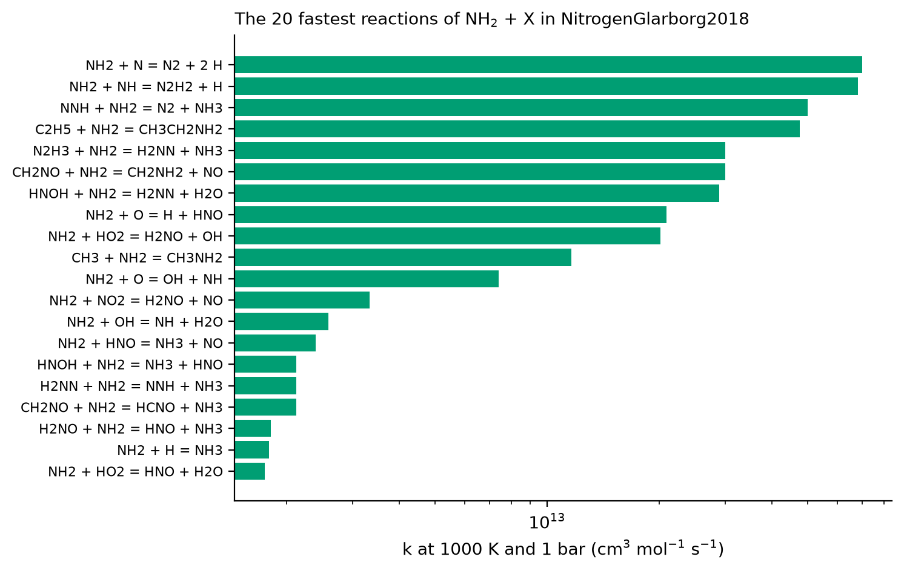

# 8. List the reactions of one species in one model

**Question.** In the model NitrogenGlarborg2018, which reactions consume NH<sub>2</sub>, and which of them are the fastest at 1000 K?

## How the API answers the question

1. **Request**

    ```bash
    curl "https://pr.omethe.us/api/kineticmodel/?search=NitrogenGlarborg2018&fields=id,model_name"
    ```

    **Response:** The model record, 37.

2. **Request**

    ```bash
    curl "https://pr.omethe.us/api/kinetics/?kinetic_model=37&species=16381"
    ```

    **Response:** The rate records of this model for the reactions that contain NH<sub>2</sub> (species record 16381).

3. **Request**

    ```bash
    curl "https://pr.omethe.us/api/reaction/?id__in=<the reaction IDs of these rate records>"
    ```

    **Response:** The reaction records, with their stoichiometry.

4. **Request**

    ```bash
    curl "https://pr.omethe.us/api/kineticmodel/37/?fields=speciesname_set"
    ```

    **Response:** The names that this model uses for its species, for the equations of the plot.

## Code

[Download uc08_reactions_of_species.py](code/uc08_reactions_of_species.py). The script needs the two [helper files](index.md#running-the-scripts).

```python
--8<-- "code/uc08_reactions_of_species.py"
```

## Result

```text
--8<-- "output/uc08_reactions_of_species.txt"
```

## Plot



## What the result shows

- The fastest reactions with NH<sub>2</sub> as a reactant are reactions with other radicals, for example NH<sub>2</sub> + N and NH<sub>2</sub> + NH.

!!! note
    The script keeps the reactions that the model writes with NH<sub>2</sub> as a reactant and with two reactants. A reaction that the model writes in the other direction can also consume NH<sub>2</sub>.
