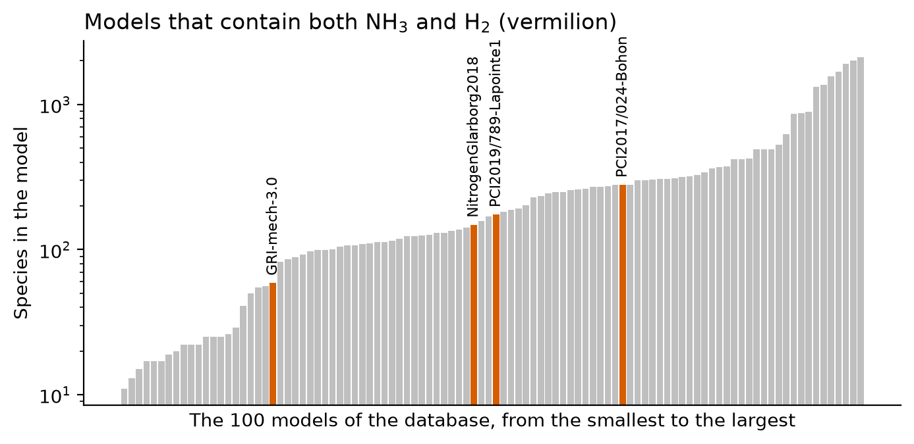

# 9. Find the models that contain two species

**Question.** Which kinetic models contain both NH<sub>3</sub> and H<sub>2</sub>, and how large are they?

## How the API answers the question

1. **Request**

    ```bash
    curl "https://pr.omethe.us/api/kineticmodel/?species=16374&species=5&fields=id,model_name"
    ```

    **Response:** The models that contain both NH<sub>3</sub> (species record 16374) and H<sub>2</sub> (5). A repeated `species` parameter selects the models that contain every species given.

2. **Request**

    ```bash
    curl "https://pr.omethe.us/api/kineticmodel/?fields=id,model_name,speciesname_set"
    ```

    **Response:** The species list of every model. The number of species records in the list is the size of the model.

## Code

[Download uc09_models_with_species.py](code/uc09_models_with_species.py). The script needs the two [helper files](index.md#running-the-scripts).

```python
--8<-- "code/uc09_models_with_species.py"
```

## Result

```text
--8<-- "output/uc09_models_with_species.txt"
```

## Plot



## What the result shows

- Only four models contain both NH<sub>3</sub> and H<sub>2</sub>. The smallest is GRI-mech-3.0 and the largest is PCI2017/024-Bohon.
