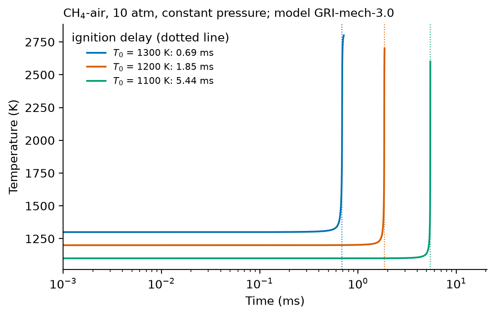

# 10. Download a model and simulate an ignition

**Question.** How do I download a kinetic model in Cantera format and calculate the ignition delay of a stoichiometric methane-air mixture at 10 atm?

## How the API answers the question

1. **Request**

    ```bash
    curl "https://pr.omethe.us/api/kineticmodel/?search=GRI-mech-3.0&fields=id,model_name"
    ```

    **Response:** The model record, 41.

2. **Request**

    ```bash
    curl "https://pr.omethe.us/kineticmodel/41/download/cantera"
    ```

    **Response:** The model as a Cantera YAML file. Its `description` says which lines of the model's own CHEMKIN file it does not contain, and why.

3. **Request**

    ```bash
    curl "https://pr.omethe.us/api/kineticmodel/41/?fields=speciesname_set"
    ```

    **Response:** The names that this model uses for its species. With the species records of CH<sub>4</sub>, O<sub>2</sub> and N<sub>2</sub>, the script finds the names of these species in the model. Thus it does not guess the names.

The script loads the file in Cantera and integrates a constant-pressure reactor. The ignition delay is the time of the largest rate of temperature rise.

## Code

[Download uc10_download_and_simulate.py](code/uc10_download_and_simulate.py). The script needs the two [helper files](index.md#running-the-scripts).

```python
--8<-- "code/uc10_download_and_simulate.py"
```

## Result

```text
--8<-- "output/uc10_download_and_simulate.txt"
```

## Plot



## What the result shows

- The ignition delay increases from about 0.7 ms at 1300 K to about 5 ms at 1100 K.
- Cantera gives four warnings when it loads the file: the NASA polynomials of CH2OOH and HOCHO are discontinuous at 1000 K. These discontinuities are in the thermochemistry of the model.

!!! note
    The same download path gives `chemkin` (a ZIP file with the CHEMKIN files) instead of `cantera`.
