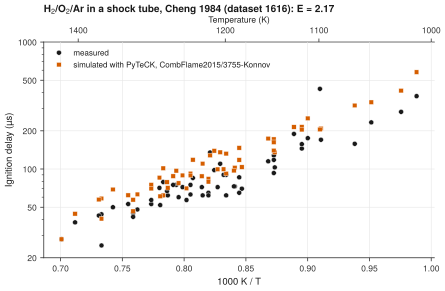

# 10. Simulate a dataset with a model in PyTeCK

**Question.** How well does one kinetic model reproduce the ignition delays of one experimental dataset? [PyTeCK](https://github.com/pr-omethe-us/PyTeCK) simulates each datapoint of a ChemKED file with a Cantera model, as the experiment defines it.

## How the API answers the question

1. **Request**

    ```bash
    curl "https://pr.omethe.us/chemked/dataset/1616/export/?format=yaml"
    ```

    **Response:** The ChemKED file of dataset 1616 (Cheng 1984: H<sub>2</sub>/O<sub>2</sub>/Ar in a shock tube). The file gives each datapoint and the ignition criterion, here the largest rate of pressure rise.

2. **Request**

    ```bash
    curl "https://pr.omethe.us/kineticmodel/125/download/cantera"
    ```

    **Response:** The model CombFlame2015/3755-Konnov (model record 125) as a Cantera YAML file.

3. **Request**

    ```bash
    curl "https://pr.omethe.us/api/kineticmodel/125/?fields=speciesname_set"
    ```

    **Response:** The names that this model uses for its species, with the species record of each name.

4. **Request**

    ```bash
    curl "https://pr.omethe.us/api/species/?inchi=1S/O2/c1-2&has_electronic_state=false"
    ```

    **Response:** The species records of one mixture component, from the InChI that the ChemKED file gives for it. The script does the same for each component (Ar, H<sub>2</sub>, O<sub>2</sub>).

PyTeCK needs a species key: the name that the model uses for each component of the mixture. The script builds this key from the species records, so it does not guess the names. Then `run_pyteck` in [pyteck_tools.py](code/pyteck_tools.py) gives the ChemKED file, the model file and the species key to PyTeCK. PyTeCK makes one simulation for each datapoint, runs it in Cantera and finds the ignition delay with the criterion of the dataset. The function runs the simulations one after the other, so the script needs no worker processes.

## Code

[Download uc10_simulate_with_pyteck.py](code/uc10_simulate_with_pyteck.py). The script imports [prometheus_api.py](code/prometheus_api.py) and [pyteck_tools.py](code/pyteck_tools.py); put them in the same folder (see [Running the scripts](index.md#running-the-scripts)). A line `# %%` starts each cell, so an editor such as VS Code or Jupyter can run the script one cell at a time.

**1. Imports**

```python
--8<-- "code/uc10_simulate_with_pyteck.py:4:9"
```

**2. The dataset (hydrogen/Cheng_1984: H2/O2/Ar in a shock tube) and the model**

```python
--8<-- "code/uc10_simulate_with_pyteck.py:12:13"
```

**3. Download the ChemKED file and the Cantera file**

```python
--8<-- "code/uc10_simulate_with_pyteck.py:16:17"
```

**4. PyTeCK's species key: the name in the model of each mixture component, by the InChI**

```python
--8<-- "code/uc10_simulate_with_pyteck.py:20:22"
```

**5. Simulate each datapoint with PyTeCK**

```python
--8<-- "code/uc10_simulate_with_pyteck.py:25:30"
```

**6. Plot the measured and the simulated ignition delays against 1000/T**

```python
--8<-- "code/uc10_simulate_with_pyteck.py:33:45"
```

## Result

```text
--8<-- "output/uc10_simulate_with_pyteck.txt"
```

## Plot



## What the result shows

- The model gives ignition delays that are a median of about 1.3 times the measured delays.
- PyTeCK's error function E is the mean of ((ln τ<sub>sim</sub> − ln τ<sub>exp</sub>)/σ)<sup>2</sup>, where σ is the scatter of the measured ln τ around a smooth fit. E of about 2 means that the model misses the data by about 1.5 times their scatter.

!!! note
    The Konnov model contains O<sub>2</sub> and its singlet state, O2X. Both species records have the same standard InChI, so the script takes the triplet, the ground state of O<sub>2</sub>.

!!! note
    PyTeCK finds the species of a species-based ignition criterion, such as OH*, by its name only. A model can name excited OH differently (for example `OHX`), and with Cantera 3.2, PyTeCK 0.2.6 stops when the model does not have the exact name. Thus `species_key` also finds the model's name of the target species through the species records (for excited OH, `/api/species/?inchi=1S/HO/h1H&has_electronic_state=true`), and `run_pyteck` gives this name to PyTeCK.
