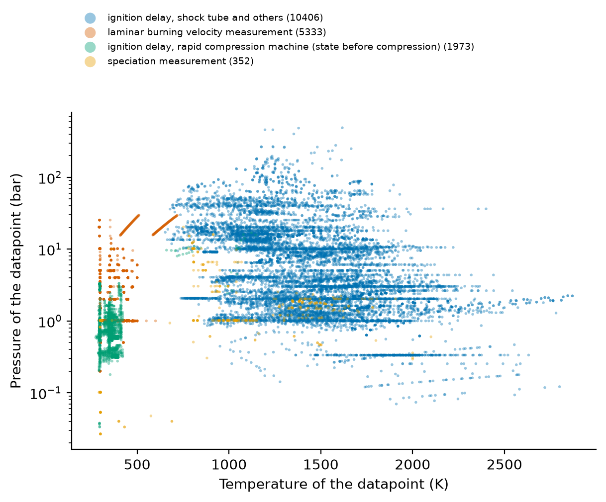

# 11. Map the conditions of the experiments

**Question.** At which temperatures and pressures did the experiments of the collection measure their data?

## How the API answers the question

1. **Request**

    ```bash
    curl "https://pr.omethe.us/api/experiment-datapoint/?fields=id,temperature,pressure,dataset&page_size=1000"
    ```

    **Response:** The temperature (K) and pressure (Pa) of every datapoint. `fields` keeps the response small.

2. **Request**

    ```bash
    curl "https://pr.omethe.us/api/experiment-dataset/?fields=id,experiment_type,apparatus&page_size=1000"
    ```

    **Response:** The experiment type and the apparatus of every dataset.

## Code

[Download uc11_experiment_coverage.py](code/uc11_experiment_coverage.py). The script needs the two [helper files](index.md#running-the-scripts).

```python
--8<-- "code/uc11_experiment_coverage.py"
```

## Result

```text
--8<-- "output/uc11_experiment_coverage.txt"
```

## Plot



## What the result shows

- Ignition delays cover the widest range: from below 1 bar to several hundred bar.
- Laminar burning velocities are measured at the temperature of the unburnt gas, from about 300 to 700 K.

!!! note
    Most datapoints of rapid compression machines give the temperature and pressure before compression, not the compressed state. The plot shows them apart. For the compressed state, use the volume histories (`/api/volume-history/`).
