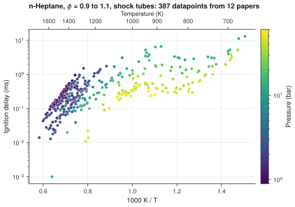

# 12. Collect the ignition delays of one fuel

**Question.** Which shock-tube ignition delays of stoichiometric n-heptane mixtures does the collection hold, and how do they depend on temperature and pressure?

## How the API answers the question

1. **Request**

    ```bash
    curl "https://pr.omethe.us/api/ignition-delay/?inchi=1S/C7H16/c1-3-5-7-6-4-2/h3-7H2,1-2H3&datapoint__equivalence_ratio__gte=0.9&datapoint__equivalence_ratio__lte=1.1&expand=datapoint"
    ```

    **Response:** The ignition delays (s) of mixtures that contain n-heptane, at an equivalence ratio of 0.9 to 1.1. `expand=datapoint` gives the temperature and pressure of each datapoint in the same response.

2. **Request**

    ```bash
    curl "https://pr.omethe.us/api/experiment-dataset/?id__in=<the dataset IDs>&fields=id,reference_doi,reference_year,apparatus"
    ```

    **Response:** The paper and the apparatus of each dataset. The script keeps the shock tubes.

## Code

[Download uc12_ignition_delays.py](code/uc12_ignition_delays.py). The script needs the two [helper files](index.md#running-the-scripts).

```python
--8<-- "code/uc12_ignition_delays.py"
```

## Result

```text
--8<-- "output/uc12_ignition_delays.txt"
```

## Plot



## What the result shows

- At a given temperature, the ignition delay decreases when the pressure increases.
- Between 1000/T = 1.1 and 1.4 (about 900 to 700 K), the ignition delay changes little with temperature. This is the negative-temperature-coefficient region of n-heptane.

!!! note
    The script leaves out the rapid compression machines, because most of their datapoints give the temperature before compression (see use case 11).
