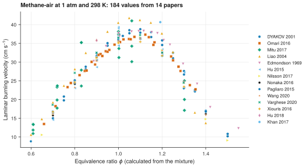

# 13. Compare the burning velocities of several laboratories

**Question.** Which laminar burning velocities of methane-air flames at 1 atm and 298 K does the collection hold, and do the laboratories agree?

## How the API answers the question

1. **Request**

    ```bash
    curl "https://pr.omethe.us/api/laminar-burning-velocity/?inchi=1S/CH4/h1H4&datapoint__pressure__gte=90000&datapoint__pressure__lte=110000&datapoint__temperature__gte=290&datapoint__temperature__lte=305&expand=datapoint"
    ```

    **Response:** The burning velocities (m/s) of mixtures that contain CH<sub>4</sub>, at 0.9 to 1.1 bar and 290 to 305 K. The filters take SI values.

2. **Request**

    ```bash
    curl "https://pr.omethe.us/api/experiment-dataset/?id__in=<the dataset IDs>&fields=id,reference_doi,chemked_file_path,common_properties"
    ```

    **Response:** For each dataset: its file, and the mixture that it gives once for all its datapoints.

The script keeps the mixtures that contain only CH<sub>4</sub>, O<sub>2</sub> and N<sub>2</sub>, with N<sub>2</sub>/O<sub>2</sub> = 3.6 to 3.9 (air). It calculates the equivalence ratio from the mixture, because some datapoints do not give it.

## Code

[Download uc13_burning_velocity.py](code/uc13_burning_velocity.py). The script needs the two [helper files](index.md#running-the-scripts).

```python
--8<-- "code/uc13_burning_velocity.py"
```

## Result

```text
--8<-- "output/uc13_burning_velocity.txt"
```

## Plot



## What the result shows

- Near φ = 1, the burning velocities of the different papers are between about 31 and 41 cm/s.
- The burning velocity is largest at φ of about 1.05 to 1.1.

!!! note
    Most of the burning velocities that the first request gives are not methane-air: their mixture has another diluent, such as Ar or He, or a second fuel.

!!! note
    The legend names each paper by the folder of its file (first author and year).
