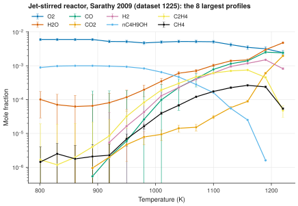

# 14. Plot the species profiles of one experiment

**Question.** In the jet-stirred-reactor experiments of the collection, which measurement gives the most species profiles against temperature, and what do the profiles show?

## How the API answers the question

1. **Request**

    ```bash
    curl "https://pr.omethe.us/api/speciation-measurement/?datapoint__dataset__apparatus__kind=jet%20stirred%20reactor&expand=datapoint"
    ```

    **Response:** The speciation measurements of jet-stirred reactors. `independent_variables` gives the variables of each measurement, in column order.

2. **Request**

    ```bash
    curl "https://pr.omethe.us/api/concentration-profile/?measurement__datapoint__dataset__apparatus__kind=jet%20stirred%20reactor"
    ```

    **Response:** All their concentration profiles. Each row of `values` gives the independent variables, then the mole fraction, then (in some files) the uncertainty of that row.

3. **Request**

    ```bash
    curl "https://pr.omethe.us/api/experiment-dataset/1225/?fields=id,reference_doi,reference_year,reference_authors,chemked_file_path"
    ```

    **Response:** The paper and the file of the chosen dataset.

## Code

[Download uc14_species_profiles.py](code/uc14_species_profiles.py). The script imports [prometheus_api.py](code/prometheus_api.py); put it in the same folder (see [Running the scripts](index.md#running-the-scripts)). A line `# %%` starts each cell, so an editor such as VS Code or Jupyter can run the script one cell at a time.

**1. Imports**

```python
--8<-- "code/uc14_species_profiles.py:4:8"
```

**2. All speciation measurements of jet-stirred reactors, and all their concentration profiles (2 requests)**

```python
--8<-- "code/uc14_species_profiles.py:11:15"
```

**3. The measurement against temperature with the most profiles, and its dataset**

```python
--8<-- "code/uc14_species_profiles.py:18:20"
```

**4. A row of a profile: the independent variables, the value, and (when there is one) the uncertainty**

```python
--8<-- "code/uc14_species_profiles.py:23:29"
```

**5. Plot the 8 profiles with the largest mole fractions, with their uncertainties**

```python
--8<-- "code/uc14_species_profiles.py:32:51"
```

## Result

```text
--8<-- "output/uc14_species_profiles.txt"
```

## Plot



## What the result shows

- The chosen measurement is the oxidation of n-butanol in a jet-stirred reactor at 1 atm (Sarathy 2009).
- Above about 900 K, the mole fractions of n-butanol and O<sub>2</sub> decrease, and the mole fractions of CO, H<sub>2</sub>O and CO<sub>2</sub> increase.

!!! note
    The error bars give the evaluated standard deviation of each row (the third column of `values`; `evaluated_standard_deviation_type` is `absolute`).

!!! note
    The title names the paper by the folder of its file. For this dataset, the order of `reference_authors` in the API differs from the paper.
