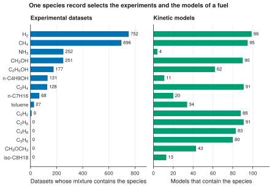

# 15. Join the experiments and the models of a fuel

**Question.** For which fuels does the database hold both experiments and kinetic models?

## How the API answers the question

1. **Request**

    ```bash
    curl "https://pr.omethe.us/api/experiment-dataset/?species=16374&page_size=1"
    ```

    **Response:** The experimental datasets whose mixture contains NH<sub>3</sub> (species record 16374). Only the `count` of the response is needed, so `page_size=1` is enough.

2. **Request**

    ```bash
    curl "https://pr.omethe.us/api/kineticmodel/?species=16374&page_size=1&fields=id"
    ```

    **Response:** The kinetic models that contain NH<sub>3</sub>. The same species record selects the experiments and the models.

## Code

[Download uc15_fuels_experiments_models.py](code/uc15_fuels_experiments_models.py). The script imports [prometheus_api.py](code/prometheus_api.py); put it in the same folder (see [Running the scripts](index.md#running-the-scripts)). A line `# %%` starts each cell, so an editor such as VS Code or Jupyter can run the script one cell at a time.

**1. Imports**

```python
--8<-- "code/uc15_fuels_experiments_models.py:3:13"
```

**2. One species record selects the experiments (by the mixture) and the models (by the species list)**

```python
--8<-- "code/uc15_fuels_experiments_models.py:16:22"
```

**3. Plot the datasets and the models of each fuel side by side**

```python
--8<-- "code/uc15_fuels_experiments_models.py:25:40"
```

## Result

```text
--8<-- "output/uc15_fuels_experiments_models.txt"
```

## Plot



## What the result shows

- NH<sub>3</sub> is in many experimental datasets but in only four models.
- Ethane, propane, propene, dimethyl ether and iso-octane are in many models, but the collection has no experiment with them.

!!! note
    A dataset counts when its mixture contains the species, as a fuel or as another component.
