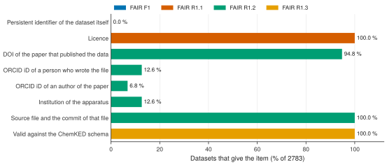

# 16. Count the FAIR metadata of the experiments

**Question.** How many experimental datasets give each item of FAIR metadata?

## How the API answers the question

1. **Request**

    ```bash
    curl "https://pr.omethe.us/api/experiment-dataset/?fields=id,reference_doi,file_doi,license,file_authors,reference_authors,apparatus,chemked_file_path,source_commit,is_valid&page_size=1000"
    ```

    **Response:** The metadata of all datasets. With `page_size=1000`, three requests give all of them.

2. **Request**

    ```bash
    curl "https://pr.omethe.us/api/license/"
    ```

    **Response:** The licences that a dataset can link to, with their SPDX identifiers.

## Code

[Download uc16_fair_metadata.py](code/uc16_fair_metadata.py). The script needs the two [helper files](index.md#running-the-scripts).

```python
--8<-- "code/uc16_fair_metadata.py"
```

## Result

```text
--8<-- "output/uc16_fair_metadata.txt"
```

## Plot



## What the result shows

- Each dataset gives a licence (CC-BY-4.0), its source file and the commit of that file.
- Almost every dataset gives the DOI of its paper, but no dataset has a DOI of its own.
- Few datasets give an ORCID iD of a file author or of a paper author.

!!! note
    The same requests count the metadata again after each release, so anyone can see how the metadata change.
