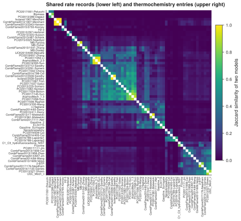

# 16. Find the models that were built from the same parts

**Question.** Which kinetic models share most of their rate expressions and their thermochemistry?

## How the API answers the question

1. **Request**

    ```bash
    curl "https://pr.omethe.us/api/kineticmodel/?fields=id,model_name,kineticscomment_set&page_size=1000"
    ```

    **Response:** For each model, the IDs of the rate records that the model links to. A rate record is stored once, so two models that use the same rate expression link to the same rate record.

2. **Request**

    ```bash
    curl "https://pr.omethe.us/api/kineticmodel/?fields=id,model_name,thermocomment_set&page_size=1000"
    ```

    **Response:** For each model, the IDs of the thermochemistry entries that the model links to.

For each pair of models, the script calculates the Jaccard similarity: the number of records that both models link to, divided by the number of records that one or both models link to. A similarity of 1 means that the two models have the same rate records (or the same thermochemistry entries). The script then orders the models by hierarchical clustering (SciPy), so that similar models are neighbours in the plot.

## Code

[Download uc16_model_similarity.py](code/uc16_model_similarity.py). The script imports [prometheus_api.py](code/prometheus_api.py); put it in the same folder (see [Running the scripts](index.md#running-the-scripts)). A line `# %%` starts each cell, so an editor such as VS Code or Jupyter can run the script one cell at a time.

**1. Imports**

```python
--8<-- "code/uc16_model_similarity.py:4:9"
```

**2. The rate records and the thermochemistry entries that each model links to (2 large requests)**

```python
--8<-- "code/uc16_model_similarity.py:12:13"
```

**3. Jaccard similarity: the records that two models share, divided by the records of either model**

```python
--8<-- "code/uc16_model_similarity.py:16:19"
```

**4. Print the pairs of models that share the most rate records**

```python
--8<-- "code/uc16_model_similarity.py:22:27"
```

**5. Keep the models that share at least 30 % of their rate records with another model, and cluster them**

```python
--8<-- "code/uc16_model_similarity.py:30:33"
```

**6. Plot both similarities in one matrix: rate records below the diagonal, thermochemistry above**

```python
--8<-- "code/uc16_model_similarity.py:36:47"
```

## Result

```text
--8<-- "output/uc16_model_similarity.txt"
```

## Plot



## What the result shows

- Of the 4,656 pairs of models, 78 pairs share more than half of their rate records, and 2,057 pairs share less than 1 %.
- The squares along the diagonal are families of models: the models of the AramcoMech family, the models that start from USC Mech II, and three models from the same group (Biomass, PCI2017/051-Pelucchi and PCI2013/289-Dagaut).
- Three model records have the same rate records and the same thermochemistry entries (similarity 1.00): CombFlame2013/1907-Merchant, butanol/1907-Merchant and CombFlame2013/2343-Hansen. The first two are one model, imported two times. That the third model is identical to them is a finding to check against the files that its authors published.
- The two triangles of the matrix are almost mirror images: models that share their rate records also share their thermochemistry.

!!! note
    The script needs SciPy (`pip install scipy`) for the clustering.
