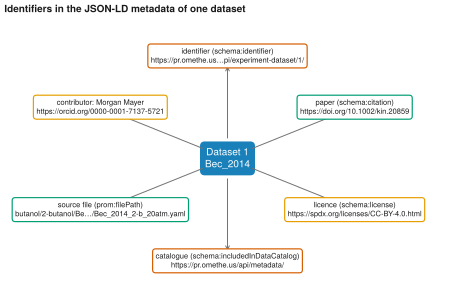

# 17. Read the identifiers of one dataset

**Question.** Which persistent identifiers link one experimental dataset to its paper, its authors, its licence and the data catalogue?

## How the API answers the question

1. **Request**

    ```bash
    curl "https://pr.omethe.us/api/experiment-dataset/?fields=id,file_authors&ordering=id"
    ```

    **Response:** The file authors of each dataset. The script takes the first dataset whose file author has an ORCID iD.

2. **Request**

    ```bash
    curl "https://pr.omethe.us/api/experiment-dataset/1/metadata/"
    ```

    **Response:** The metadata of the dataset as schema.org JSON-LD.

## Code

[Download uc17_identifiers_jsonld.py](code/uc17_identifiers_jsonld.py). The script imports [prometheus_api.py](code/prometheus_api.py); put it in the same folder (see [Running the scripts](index.md#running-the-scripts)). A line `# %%` starts each cell, so an editor such as VS Code or Jupyter can run the script one cell at a time.

**1. Imports**

```python
--8<-- "code/uc17_identifiers_jsonld.py:5:9"
```

**2. The first dataset (lowest ID) whose file author has an ORCID iD, and its JSON-LD metadata**

```python
--8<-- "code/uc17_identifiers_jsonld.py:12:14"
```

**3. The identifiers in the metadata**

```python
--8<-- "code/uc17_identifiers_jsonld.py:17:25"
```

**4. Draw the dataset in the centre and one box for each identifier around it**

```python
--8<-- "code/uc17_identifiers_jsonld.py:28:43"
```

## Result

```text
--8<-- "output/uc17_identifiers_jsonld.txt"
```

## Plot



## What the result shows

- `schema:identifier` gives the URL of the dataset in the API, `schema:citation` gives the DOI of the paper, and `schema:license` gives the licence as an SPDX URL.
- Each contributor has an ORCID iD, and `schema:includedInDataCatalog` gives the catalogue of the whole collection (`/api/metadata/`).
