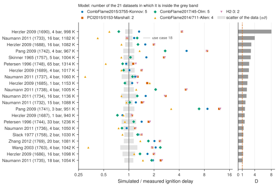

# 17. Find the experiments that discriminate between models

**Question.** Five small hydrogen models are simulated in PyTeCK for every shock-tube dataset of H<sub>2</sub>/O<sub>2</sub> ignition. Which experiments give the largest differences between the models, compared with the scatter of the data? Such experiments can show which model is right.

## How the API answers the question

1. **Request**

    ```bash
    curl "https://pr.omethe.us/api/ignition-delay/?inchi=1S/H2/h1H&expand=datapoint&fields=datapoint&page_size=1000"
    ```

    **Response:** The datapoints of all ignition delays of mixtures with H<sub>2</sub>, with their mixtures. The script keeps the datasets whose mixtures hold only H<sub>2</sub>, O<sub>2</sub> and diluents.

2. **Request**

    ```bash
    curl "https://pr.omethe.us/api/experiment-dataset/?id__in=1609,1610,...&fields=id,chemked_file_path,apparatus"
    ```

    **Response:** The apparatus of these datasets, to keep the shock tubes.

3. **Request**

    ```bash
    curl "https://pr.omethe.us/kineticmodel/125/download/cantera"
    ```

    **Response:** The Cantera file of each model, and (`/api/kineticmodel/125/?fields=speciesname_set`) its species names.

4. **Request**

    ```bash
    curl "https://pr.omethe.us/chemked/dataset/1733/export/?format=yaml"
    ```

    **Response:** The ChemKED file of each dataset.

For each dataset and each model, `run_pyteck` simulates every datapoint. For each datapoint, the spread is the standard deviation of ln τ<sub>sim</sub> between the five models. The discrimination D of a dataset is the median spread divided by σ, the scatter of the measured ln τ that PyTeCK estimates. When D is larger than 1, the models differ more than the data scatter, so the dataset can tell the models apart.

The plot gives one row for each dataset with D larger than 1. In each row, a marker gives the median ratio of the simulated delay to the measured delay for one model. The grey band gives the scatter of the measured delays, from e<sup>−σ</sup> to e<sup>σ</sup>. A model whose marker is in the band agrees with the dataset within the scatter of the data. The bar at the right gives D.

## Code

[Download uc17_discriminating_experiments.py](code/uc17_discriminating_experiments.py). The script imports [prometheus_api.py](code/prometheus_api.py) and [pyteck_tools.py](code/pyteck_tools.py); put them in the same folder (see [Running the scripts](index.md#running-the-scripts)). A line `# %%` starts each cell, so an editor such as VS Code or Jupyter can run the script one cell at a time.

**1. Imports**

```python
--8<-- "code/uc17_discriminating_experiments.py:5:16"
```

**2. The shock-tube datasets whose mixtures hold only H2, O2 and diluents**

```python
--8<-- "code/uc17_discriminating_experiments.py:19:22"
```

**3. The five models: their Cantera files and their species names**

```python
--8<-- "code/uc17_discriminating_experiments.py:25:28"
```

**4. Simulate each dataset with each model (a dataset that a model cannot simulate is left out)**

```python
--8<-- "code/uc17_discriminating_experiments.py:31:39"
```

**5. Discrimination D: the spread of ln(simulated delay) between the models, divided by the scatter sigma of the data**

```python
--8<-- "code/uc17_discriminating_experiments.py:42:58"
```

**6. The datasets with D > 1: which model agrees with the data, and which models agree with each other**

```python
--8<-- "code/uc17_discriminating_experiments.py:61:78"
```

**7. Plot: for each dataset with D > 1, the simulated / measured delay of each model and the scatter of the data**

```python
--8<-- "code/uc17_discriminating_experiments.py:81:113"
```

## Result

```text
--8<-- "output/uc17_discriminating_experiments.txt"
```

## Plot



## What the result shows

- In 21 of 45 datasets, the five models differ more than the scatter of the data (D > 1). The median temperatures of these datasets are 940 to 1314 K, near the crossover temperature of hydrogen. There, the chain branching H + O<sub>2</sub> = O + OH and the chain termination H + O<sub>2</sub> (+M) = HO<sub>2</sub> (+M) have similar rates, so small differences in their rate coefficients change the ignition delay strongly.
- All nine datasets with a median temperature above 1314 K have D < 1. There, the five models give almost the same delays, so these datasets cannot tell the models apart.
- In the datasets with D > 1, no model is in the grey band in more than 5 of the 21 datasets (Konnov and Olm: 5, Allen: 4, Marshall and H2-3: 2). Thus, near the crossover temperature, none of the five models agrees with most of the datasets within the scatter of the data.
- CombFlame2014/711-Allen gives the shortest delays of the five models in 19 of the 21 datasets.
- The markers of PCI2015/0153-Marshall and H2-3 are on top of each other in almost every row: the median difference between their delays is 1.5 %. Thus these datasets cannot tell these two models apart.
- In dataset 1733 (Naumann 2011, 16 bar, 1182 K), Allen gives 0.42 times the measured delays, and the other four models give 0.95 to 1.26 times the measured delays. [Use case 18](uc18.md) finds the reactions that cause the difference between Allen and Olm.
- In the two datasets of Pang 2009 (951 and 967 K), all five models give longer delays than the measured delays: the median ratios are 1.35 to 12.4. The ChemKED files of these datasets give no pressure rise behind the reflected shock (`pressure-rise`), so PyTeCK keeps the volume constant. Near 950 K, a small pressure rise in the shock tube makes the ignition delay much shorter, and Pang 2009 is a study of this effect. Thus a part of these differences can come from the shock tube and not from the chemistry.
- Over all datasets, CombFlame2017/45-Olm has the lowest mean error function (E = 26.0), and PCI2015/0153-Marshall the highest (43.1).

!!! note
    The script makes about 3,500 simulations and runs for about 4 minutes.

!!! note
    In four datasets (1613, 1614, 1615 and 1747), PyTeCK finds no ignition in the simulation of a model, so the script leaves them out.
