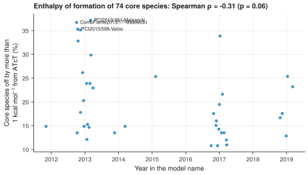

# 19. Compare the enthalpies of old and new models with ATcT

**Question.** Do newer kinetic models use enthalpies of formation that are closer to the Active Thermochemical Tables (ATcT)?

## How the API answers the question

1. **Request**

    ```bash
    curl "https://pr.omethe.us/api/thermo-record/?provider=atct&page_size=1000"
    ```

    **Response:** The ATcT reference records: for each species record, the ATcT enthalpy of formation at 298.15 K.

2. **Request**

    ```bash
    curl "https://pr.omethe.us/api/thermo/?reference=false&page_size=1000"
    ```

    **Response:** All the thermochemistry entries of the models (about 20 requests).

3. **Request**

    ```bash
    curl "https://pr.omethe.us/api/kineticmodel/?fields=id,model_name,thermocomment_set&page_size=1000"
    ```

    **Response:** For each model, the thermochemistry entries that it links to.

The core species are the species with an ATcT value that at least half of the models contain. For each model, the script counts the core species whose enthalpy of formation differs from ATcT by more than 1 kcal/mol (4.184 kJ/mol). The model records have no field for the year, so the script reads the year from the model name, for example `CombFlame2015/3755-Konnov` (2015) or `NitrogenGlarborg2018` (2018).

## Code

[Download uc19_enthalpy_by_model_year.py](code/uc19_enthalpy_by_model_year.py). The script imports [prometheus_api.py](code/prometheus_api.py) and [chem_tools.py](code/chem_tools.py); put them in the same folder (see [Running the scripts](index.md#running-the-scripts)). A line `# %%` starts each cell, so an editor such as VS Code or Jupyter can run the script one cell at a time.

**1. Imports**

```python
--8<-- "code/uc19_enthalpy_by_model_year.py:4:11"
```

**2. The ATcT enthalpies of formation at 298.15 K (kJ/mol), by species record**

```python
--8<-- "code/uc19_enthalpy_by_model_year.py:14:14"
```

**3. The thermochemistry entries of the models (about 20 requests), and the entries of each model**

```python
--8<-- "code/uc19_enthalpy_by_model_year.py:17:19"
```

**4. The core species: species with an ATcT value that at least half of the models contain**

```python
--8<-- "code/uc19_enthalpy_by_model_year.py:22:23"
```

**5. The year in the model name: "CombFlame2015/3755-Konnov" and "NitrogenGlarborg2018", not "butanol/2028-Sarathy"**

```python
--8<-- "code/uc19_enthalpy_by_model_year.py:26:28"
```

**6. For each model with a year and most core species: the share of core species off by more than 1 kcal/mol**

```python
--8<-- "code/uc19_enthalpy_by_model_year.py:31:43"
```

**7. Plot the share of each model against its year (a small sideways shift keeps equal points apart)**

```python
--8<-- "code/uc19_enthalpy_by_model_year.py:46:55"
```

## Result

```text
--8<-- "output/uc19_enthalpy_by_model_year.txt"
```

## Plot



## What the result shows

- About one core species in five is more than 1 kcal/mol from ATcT, in the models of each year from 2012 to 2019.
- The share decreases a little with the year (Spearman ρ = −0.31), but the decrease is not significant (p = 0.06). Thus the models of 2019 are not much closer to ATcT than the models of 2013.

!!! note
    Only 39 of the 100 models have a year in their name and most of the core species. A field for the year of publication in the model record would let a program include all models.

!!! note
    The ATcT values in the database are from ATcT version 1.220. Some models are older than the ATcT values that they are compared with.
