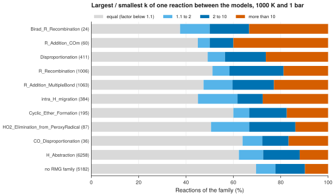

# 20. Compare the rate coefficients of the models by reaction family

**Question.** For which reaction families do the kinetic models disagree most on the rate coefficient of the same reaction?

## How the API answers the question

1. **Request**

    ```bash
    curl "https://pr.omethe.us/api/reaction/?ordering=id&page_size=1000"
    ```

    **Response:** All reaction records (about 40 requests). The field `rmg_family` gives the RMG reaction family of the reaction, for example `H_Abstraction`.

2. **Request**

    ```bash
    curl "https://pr.omethe.us/api/kinetics/?ordering=id&page_size=1000"
    ```

    **Response:** All rate records (about 60 requests).

3. **Request**

    ```bash
    curl "https://pr.omethe.us/api/kineticmodel/?fields=id,model_name,kineticscomment_set&page_size=1000"
    ```

    **Response:** For each model, the rate records that it links to.

For each reaction record, the script calculates the rate coefficient of each model at 1000 K and 1 bar. When a model gives a reaction two times (a duplicate reaction), the script adds the two rate coefficients. For each reaction that three or more models give, the spread is the largest rate coefficient divided by the smallest.

## Code

[Download uc20_rate_spread_by_family.py](code/uc20_rate_spread_by_family.py). The script imports [prometheus_api.py](code/prometheus_api.py) and [chem_tools.py](code/chem_tools.py); put them in the same folder (see [Running the scripts](index.md#running-the-scripts)). A line `# %%` starts each cell, so an editor such as VS Code or Jupyter can run the script one cell at a time.

**1. Imports**

```python
--8<-- "code/uc20_rate_spread_by_family.py:4:10"
```

**2. All reaction records (their RMG family), all rate records, and the rate records of each model**

```python
--8<-- "code/uc20_rate_spread_by_family.py:13:15"
```

**3. k(1000 K, 1 bar) of each reaction in each model (the sum of its rate records: duplicate reactions)**

```python
--8<-- "code/uc20_rate_spread_by_family.py:18:23"
```

**4. The spread of each reaction that at least 3 models give: largest k / smallest k**

```python
--8<-- "code/uc20_rate_spread_by_family.py:26:38"
```

**5. Plot the share of the reactions of each family in four classes of disagreement**

```python
--8<-- "code/uc20_rate_spread_by_family.py:41:56"
```

## Result

```text
--8<-- "output/uc20_rate_spread_by_family.txt"
```

## Plot



## What the result shows

- In every family, about half of the reactions or more have the same rate coefficient in all the models that give them (factor below 1.1). Most of these models copy the rate expression from a common source.
- For radical additions to CO (`R_Addition_COm`) and the recombination of biradicals (`Birad_R_Recombination`), more than 30 % of the reactions differ by more than a factor of 10 between the models.
- Of the H-atom abstractions, the largest family with 6,258 reactions, 12 % differ by more than a factor of 10.

!!! note
    Without `ordering`, the pages of a list overlap: in a test, 58,137 rows of `/api/kinetics/` gave only 34,913 different rate records. The helper `get_all` therefore orders every list by ID.
