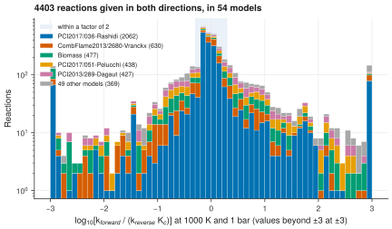

# 21. Check the detailed balance of reactions given in both directions

**Question.** Some kinetic models give a reaction in both directions, with one rate expression for each direction. Do the two rate coefficients obey detailed balance with the model's own thermochemistry?

## How the API answers the question

1. **Request**

    ```bash
    curl "https://pr.omethe.us/api/reaction/?ordering=id&page_size=1000"
    ```

    **Response:** All reaction records. Two reaction records with the same `canonical_key` are the same reaction in opposite directions.

2. **Request**

    ```bash
    curl "https://pr.omethe.us/api/kinetics/?ordering=id&page_size=1000"
    ```

    **Response:** All rate records.

3. **Request**

    ```bash
    curl "https://pr.omethe.us/api/kineticmodel/?fields=id,model_name,kineticscomment_set&page_size=1000"
    ```

    **Response:** For each model, the rate records that it links to. A model that links to rate records of both reaction records gives the reaction in both directions.

4. **Request**

    ```bash
    curl "https://pr.omethe.us/api/thermo/?id__in=2848,2849,..."
    ```

    **Response:** The thermochemistry entries of these models, 300 IDs a request.

For each pair, the script calculates log<sub>10</sub>[k<sub>forward</sub> / (k<sub>reverse</sub> K<sub>c</sub>)] at 1000 K and 1 bar. K<sub>c</sub> is the equilibrium constant from the model's own thermochemistry. The value is zero when the two rate coefficients obey detailed balance.

## Code

[Download uc21_detailed_balance.py](code/uc21_detailed_balance.py). The script imports [prometheus_api.py](code/prometheus_api.py) and [chem_tools.py](code/chem_tools.py); put them in the same folder (see [Running the scripts](index.md#running-the-scripts)). A line `# %%` starts each cell, so an editor such as VS Code or Jupyter can run the script one cell at a time.

**1. Imports**

```python
--8<-- "code/uc21_detailed_balance.py:4:11"
```

**2. All reaction records and all rate records (about 100 requests)**

```python
--8<-- "code/uc21_detailed_balance.py:14:16"
```

**3. In each model: k of each reaction record (the sum of its rate records), at 1000 K and 1 bar**

```python
--8<-- "code/uc21_detailed_balance.py:19:24"
```

**4. The pairs: two reaction records of one model with the same canonical_key, in opposite directions**

```python
--8<-- "code/uc21_detailed_balance.py:27:34"
```

**5. The thermochemistry entries of these models, by species record**

```python
--8<-- "code/uc21_detailed_balance.py:37:42"
```

**6. log10 of k_forward / (k_reverse Kc) for each pair: zero when the pair obeys detailed balance**

```python
--8<-- "code/uc21_detailed_balance.py:45:56"
```

**7. Plot the distribution of the deviation, one colour for each of the 5 models with the most pairs**

```python
--8<-- "code/uc21_detailed_balance.py:59:72"
```

## Result

```text
--8<-- "output/uc21_detailed_balance.txt"
```

## Plot



## What the result shows

- 4,403 reactions in 54 models are given in both directions. For 46 % of them, the two rate coefficients differ from detailed balance by more than a factor of 2 at 1000 K.
- The deviation belongs to a small number of models. Biomass, PCI2017/051-Pelucchi and PCI2013/289-Dagaut give many reactions as two irreversible reactions; the median deviation is a factor of 3 to 4. The same three models form one family in [use case 18](uc18.md).
- A direct calculation in Cantera with the Cantera file of Biomass gives the same median deviation as the API (log<sub>10</sub> 0.71 for 722 pairs).

!!! note
    The field `reversible` belongs to the reaction record, which all models share. When one model gives a reaction as reversible and another model gives it as irreversible, the field can show only one of them. Thus the API cannot tell whether a model gives a reaction as reversible. Of the 4,403 pairs, 3,535 include a reaction record with `reversible` = true. A field on the link between the model and the rate record would give the reversibility of each model.

!!! note
    The Cantera file of PCI2017/036-Rashidi gives 2,748 reactions in both directions, and each of them is reversible. Thus the model counts these reactions two times. This is a finding to check against the file that its authors published.
