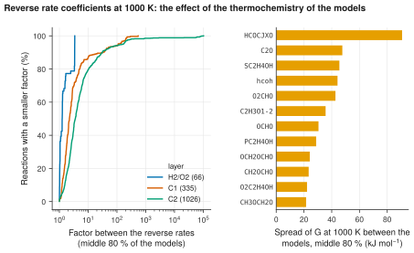

# 22. Find the effect of thermochemistry on reverse rates

**Question.** A kinetic model calculates the reverse rate coefficient of a reversible reaction from the forward rate coefficient and its own thermochemistry. For the same forward rate, how much do the reverse rates of the models differ because their thermochemistry differs?

## How the API answers the question

1. **Request**

    ```bash
    curl "https://pr.omethe.us/api/reaction/?layer__in=H2/O2,C1,C2&page_size=1000"
    ```

    **Response:** The reaction records of three layers of the chemistry. The field `layer` gives the layer of each reaction record.

2. **Request**

    ```bash
    curl "https://pr.omethe.us/api/thermo/?reference=false&page_size=1000"
    ```

    **Response:** All the thermochemistry entries of the models.

3. **Request**

    ```bash
    curl "https://pr.omethe.us/api/kineticmodel/?fields=id,model_name,thermocomment_set&page_size=1000"
    ```

    **Response:** For each model, the thermochemistry entries that it links to.

For the same forward rate coefficient, the reverse rate coefficient is proportional to 1/K<sub>c</sub>. For each reaction, the script calculates ln K<sub>c</sub> at 1000 K with the thermochemistry of each model that has all the species of the reaction. The factor between the reverse rates is exp(90th percentile − 10th percentile of ln K<sub>c</sub>): the factor for the middle 80 % of the models. One wrong entry in one model cannot change this factor.

## Code

[Download uc22_reverse_rate_from_thermo.py](code/uc22_reverse_rate_from_thermo.py). The script imports [prometheus_api.py](code/prometheus_api.py) and [chem_tools.py](code/chem_tools.py); put them in the same folder (see [Running the scripts](index.md#running-the-scripts)). A line `# %%` starts each cell, so an editor such as VS Code or Jupyter can run the script one cell at a time.

**1. Imports**

```python
--8<-- "code/uc22_reverse_rate_from_thermo.py:5:14"
```

**2. The reaction records of three layers, one direction of each reaction (same canonical_key)**

```python
--8<-- "code/uc22_reverse_rate_from_thermo.py:17:19"
```

**3. The thermochemistry entries of each model, by species record (about 20 requests)**

```python
--8<-- "code/uc22_reverse_rate_from_thermo.py:22:24"
```

**4. ln Kc at 1000 K in each model that has all the species. The factor between the reverse rates of the**

```python
--8<-- "code/uc22_reverse_rate_from_thermo.py:27:37"
```

**5. The names that most models use, for the equations**

```python
--8<-- "code/uc22_reverse_rate_from_thermo.py:40:43"
```

**6. Print the result: for each layer, the factor between the largest and the smallest reverse rate**

```python
--8<-- "code/uc22_reverse_rate_from_thermo.py:46:55"
```

**7. The cause: the species whose Gibbs energy at 1000 K differs most between the models (middle 80 %)**

```python
--8<-- "code/uc22_reverse_rate_from_thermo.py:58:66"
```

**8. Plot the distribution of the factor for each layer, and the 12 species with the largest spread**

```python
--8<-- "code/uc22_reverse_rate_from_thermo.py:69:86"
```

## Result

```text
--8<-- "output/uc22_reverse_rate_from_thermo.txt"
```

## Plot



## What the result shows

- For the H<sub>2</sub>/O<sub>2</sub> reactions, the thermochemistry of the models changes the reverse rates by a median factor of 1.25. For the C<sub>1</sub> reactions, the median factor is 2.2, and for the C<sub>2</sub> reactions it is 3.6.
- For 20 % of the C<sub>2</sub> reactions, the factor is larger than 10. A large factor comes from a few species: the Gibbs energy of OCHCO (named HCOCJXO in most models) differs by 91 kJ/mol between the models, and C<sub>2</sub>O, CH<sub>3</sub>CHOH, HCOH and O<sub>2</sub>CHO by more than 40 kJ/mol.
- Some models are a factor of 100 or more from the median of the models for many reactions. Shamel-Propane (255 reactions) gives four species, `H`, `HEG`, `HCFG` and `Halt`, that the database links to the species record of the H atom, and their thermochemistry differs. The model record GRI-mech-3.0 has 59 species, but GRI-Mech 3.0 as published has 53. Its 57 reactions contain species that GRI-Mech 3.0 does not have, such as CH<sub>3</sub>OO, OCHO and OOCHO; the Gibbs energies of these species differ from the other models by 40 to 140 kJ/mol.

!!! note
    A thermochemistry entry is used at 1000 K only when its temperature range includes 1000 K.
