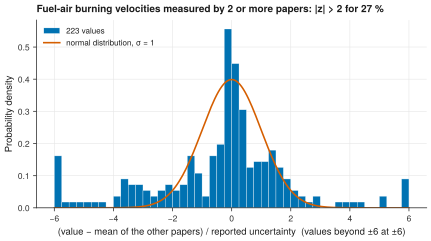

# 23. Compare the laboratories with their reported uncertainties

**Question.** When different laboratories measure the laminar burning velocity of the same fuel-air flame, do their values agree within the uncertainties that they report?

## How the API answers the question

1. **Request**

    ```bash
    curl "https://pr.omethe.us/api/laminar-burning-velocity/?expand=datapoint&page_size=1000"
    ```

    **Response:** All burning velocities, each with its value in SI units, the value and the uncertainty in the units of the file, the type and the source of the uncertainty (`reported`, `estimated`, ...) and the datapoint with its temperature, pressure and mixture.

2. **Request**

    ```bash
    curl "https://pr.omethe.us/api/experiment-dataset/?experiment_type=laminar burning velocity measurement&fields=id,reference_doi"
    ```

    **Response:** The DOI of the paper of each dataset.

The script keeps the fuel-air flames (one fuel with O<sub>2</sub> and N<sub>2</sub> in the ratio of air) with a reported uncertainty. It calculates the equivalence ratio from the mixture and the atoms of the fuel. Flames with the same fuel, a temperature within 5 K, a pressure within 5 % and an equivalence ratio within 0.05 are the same flame. For each value of a flame that two or more papers measured, z = (value − mean of the other papers) / reported uncertainty. If the reported uncertainties are correct, about 5 % of the values have |z| > 2.

## Code

[Download uc23_interlab_agreement.py](code/uc23_interlab_agreement.py). The script imports [prometheus_api.py](code/prometheus_api.py); put it in the same folder (see [Running the scripts](index.md#running-the-scripts)). A line `# %%` starts each cell, so an editor such as VS Code or Jupyter can run the script one cell at a time.

**1. Imports**

```python
--8<-- "code/uc23_interlab_agreement.py:4:12"
```

**2. All burning velocities with their datapoints, and the paper (DOI) of each dataset**

```python
--8<-- "code/uc23_interlab_agreement.py:15:17"
```

**3. Keep fuel-air flames with a reported uncertainty, and give each the equivalence ratio of its mixture**

```python
--8<-- "code/uc23_interlab_agreement.py:20:40"
```

**4. For each value: (value - mean of the other papers) / reported uncertainty, in flames from 2 or more papers**

```python
--8<-- "code/uc23_interlab_agreement.py:43:60"
```

**5. Plot the distribution of z, with the normal distribution that correct uncertainties would give**

```python
--8<-- "code/uc23_interlab_agreement.py:63:73"
```

## Result

```text
--8<-- "output/uc23_interlab_agreement.txt"
```

## Plot



## What the result shows

- 90 flames were measured by two or more papers (223 values). For 27 % of these values, |z| is larger than 2, and the median |z| is 1.04 instead of 0.67. Thus the laboratories disagree more than their reported uncertainties allow.
- The agreement depends on the fuel. For n-butanol and iso-butanol, the laboratories agree within their uncertainties. For ethanol (46 % with |z| > 2) and methanol (58 %), they do not.
- 48 reported uncertainties are less than 1 % of the value. Such small values are possibly errors in the files.

!!! note
    Some files give the burning velocity in m/s and others in cm/s. The script uses the SI value of each burning velocity and converts the uncertainty with the same factor.
