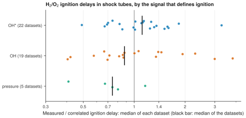

# 24. Compare the signals that define ignition

**Question.** Shock-tube experiments define ignition by different signals: the pressure, excited OH (OH*) or OH. After a correlation removes the effects of temperature, pressure and mixture, do the ignition delays of H<sub>2</sub>/O<sub>2</sub> mixtures depend on the signal?

## How the API answers the question

1. **Request**

    ```bash
    curl "https://pr.omethe.us/api/ignition-delay/?inchi=1S/H2/h1H&expand=datapoint&page_size=1000"
    ```

    **Response:** All ignition delays of mixtures with H<sub>2</sub>, each with its signal (`ignition_target`), the type of the criterion (`ignition_type`) and the datapoint.

2. **Request**

    ```bash
    curl "https://pr.omethe.us/api/experiment-dataset/?id__in=1610,1611,...&fields=id,apparatus"
    ```

    **Response:** The apparatus of each dataset, to keep the shock tubes.

The script keeps the shock-tube delays of mixtures with H<sub>2</sub>, O<sub>2</sub> and one diluent (Ar, N<sub>2</sub> or He), above the crossover temperature (pressure at most 5 bar, or temperature at least 1200 K). It fits ln τ = c<sub>0</sub> + c<sub>1</sub>(1000/T) + c<sub>2</sub> ln p + c<sub>3</sub> ln x<sub>H2</sub> + c<sub>4</sub> ln x<sub>O2</sub> + a term for the diluent, by least squares. The datapoints of one dataset share one laboratory and one signal, so the script compares the median residual of each dataset.

## Code

[Download uc24_ignition_criterion.py](code/uc24_ignition_criterion.py). The script imports [prometheus_api.py](code/prometheus_api.py); put it in the same folder (see [Running the scripts](index.md#running-the-scripts)). A line `# %%` starts each cell, so an editor such as VS Code or Jupyter can run the script one cell at a time.

**1. Imports**

```python
--8<-- "code/uc24_ignition_criterion.py:5:11"
```

**2. All ignition delays of mixtures with H2, and the apparatus of each dataset**

```python
--8<-- "code/uc24_ignition_criterion.py:14:17"
```

**3. Keep shock tubes with H2, O2 and one diluent, above the crossover temperature (p <= 5 bar, or T >= 1200 K)**

```python
--8<-- "code/uc24_ignition_criterion.py:20:28"
```

**4. A shock tube cannot measure a delay longer than about 50 ms: such values have a wrong unit**

```python
--8<-- "code/uc24_ignition_criterion.py:31:33"
```

**5. Fit ln(tau) = c0 + c1 (1000/T) + c2 ln p + c3 ln x(H2) + c4 ln x(O2) + one term for each diluent**

```python
--8<-- "code/uc24_ignition_criterion.py:36:43"
```

**6. The median residual of each dataset (its datapoints share one laboratory and one signal), by signal**

```python
--8<-- "code/uc24_ignition_criterion.py:46:53"
```

**7. Plot the dataset values for each signal**

```python
--8<-- "code/uc24_ignition_criterion.py:56:72"
```

## Result

```text
--8<-- "output/uc24_ignition_criterion.txt"
```

## Plot



## What the result shows

- The correlation fits the 514 delays of 46 datasets with a scatter of a factor of 1.8.
- The datasets that use OH* give delays 1.12 times the correlation (median of 22 datasets). The datasets that use OH give 0.88 times, and the datasets that use the pressure give 0.74 times (5 datasets).
- The differences between the signals are smaller than the differences between the datasets of one signal (from 0.4 to 3.8 times the correlation). The pressure datasets are few and old, so the laboratory and the signal are not separate here.

!!! note
    Dataset 1768 and dataset 1770 (Zhang 2012, H<sub>2</sub>/O<sub>2</sub>/Ar at 10 and 5 bar) give some ignition delays of 13,000 to 35,000 ms. A shock tube cannot measure such delays; the unit is possibly µs instead of ms. The script leaves out the delays longer than 50 ms.
