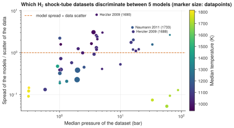

# 25. Find the experiments that discriminate between models

**Question.** Five small hydrogen models are simulated in PyTeCK for every shock-tube dataset of H<sub>2</sub>/O<sub>2</sub> ignition. Which experiments give the largest differences between the models, compared with the scatter of the data? Such experiments can show which model is right.

## How the API answers the question

1. **Request**

    ```bash
    curl "https://pr.omethe.us/api/ignition-delay/?inchi=1S/H2/h1H&expand=datapoint&fields=datapoint&page_size=1000"
    ```

    **Response:** The datapoints of all ignition delays of mixtures with H<sub>2</sub>, with their mixtures. The script keeps the datasets whose mixtures hold only H<sub>2</sub>, O<sub>2</sub> and diluents.

2. **Request**

    ```bash
    curl "https://pr.omethe.us/api/experiment-dataset/?id__in=1609,1610,...&fields=id,chemked_file_path,apparatus"
    ```

    **Response:** The apparatus of these datasets, to keep the shock tubes.

3. **Request**

    ```bash
    curl "https://pr.omethe.us/kineticmodel/125/download/cantera"
    ```

    **Response:** The Cantera file of each model, and (`/api/kineticmodel/125/?fields=speciesname_set`) its species names.

4. **Request**

    ```bash
    curl "https://pr.omethe.us/chemked/dataset/1733/export/?format=yaml"
    ```

    **Response:** The ChemKED file of each dataset.

For each dataset and each model, `run_pyteck` simulates every datapoint. For each datapoint, the spread is the standard deviation of ln τ<sub>sim</sub> between the five models. The discrimination D of a dataset is the median spread divided by σ, the scatter of the measured ln τ that PyTeCK estimates. When D is larger than 1, the models differ more than the data scatter, so the dataset can tell the models apart.

## Code

[Download uc25_discriminating_experiments.py](code/uc25_discriminating_experiments.py). The script imports [prometheus_api.py](code/prometheus_api.py) and [pyteck_tools.py](code/pyteck_tools.py); put them in the same folder (see [Running the scripts](index.md#running-the-scripts)). A line `# %%` starts each cell, so an editor such as VS Code or Jupyter can run the script one cell at a time.

**1. Imports**

```python
--8<-- "code/uc25_discriminating_experiments.py:5:14"
```

**2. The shock-tube datasets whose mixtures hold only H2, O2 and diluents**

```python
--8<-- "code/uc25_discriminating_experiments.py:17:20"
```

**3. The five models: their Cantera files and their species names**

```python
--8<-- "code/uc25_discriminating_experiments.py:23:26"
```

**4. Simulate each dataset with each model (a dataset that a model cannot simulate is left out)**

```python
--8<-- "code/uc25_discriminating_experiments.py:29:37"
```

**5. Discrimination: the spread of ln(simulated delay) between the models, divided by the scatter sigma of the data**

```python
--8<-- "code/uc25_discriminating_experiments.py:40:60"
```

**6. Plot D of each dataset against its pressure, coloured by its temperature**

```python
--8<-- "code/uc25_discriminating_experiments.py:63:78"
```

## Result

```text
--8<-- "output/uc25_discriminating_experiments.txt"
```

## Plot



## What the result shows

- In 21 of 45 datasets, the five models differ more than the scatter of the data (D > 1).
- The datasets that discriminate most are near the crossover temperature of hydrogen, at about 950 to 1200 K and 4 to 16 bar (Herzler 2009, Naumann 2011, Pang 2009, Skinner 1965). There, the chain branching H + O<sub>2</sub> = O + OH and the chain termination H + O<sub>2</sub> (+M) = HO<sub>2</sub> (+M) have similar rates, so small differences in their rate coefficients change the ignition delay strongly.
- The datasets above about 1600 K do not discriminate (D of about 0.1), at 0.3 bar as at 30 to 90 bar: there, all five models give nearly the same delays.
- Over all datasets, CombFlame2017/45-Olm has the lowest mean error function (E = 26.0), and PCI2015/0153-Marshall the highest (43.1).

!!! note
    The script makes about 3,500 simulations and runs for about 4 minutes.

!!! note
    In four datasets (1613, 1614, 1615 and 1747), PyTeCK finds no ignition in the simulation of a model, so the script leaves them out.
