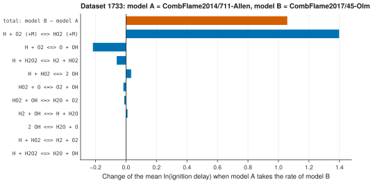

# 26. Find the reactions that make two models differ

**Question.** For dataset 1733 (Naumann 2011: H<sub>2</sub>/O<sub>2</sub>/N<sub>2</sub> at 15.7 bar), the ignition delays of CombFlame2014/711-Allen are about half of the measured delays, and the delays of CombFlame2017/45-Olm are about 1.3 times the measured delays ([use case 25](uc25.md)). Which reactions cause the difference between the two models?

## How the API answers the question

1. **Request**

    ```bash
    curl "https://pr.omethe.us/kineticmodel/186/download/cantera"
    ```

    **Response:** The Cantera file of each model (Allen: model 186, Olm: model 190).

2. **Request**

    ```bash
    curl "https://pr.omethe.us/api/kineticmodel/186/?fields=speciesname_set"
    ```

    **Response:** The names that each model uses for its species, with the species record of each name. Allen names H atoms `H(16)` and Olm names them `H`; both names link to the same species record.

3. **Request**

    ```bash
    curl "https://pr.omethe.us/chemked/dataset/1733/export/?format=yaml"
    ```

    **Response:** The ChemKED file of the dataset.

The script writes each reaction of each model with species records instead of names. Thus it finds the reactions that both models give, in the same direction. It gives model A (Allen) the rate expression of model B (Olm) for one reaction at a time, simulates the dataset in PyTeCK, and records the change of the mean ln τ.

## Code

[Download uc26_reactions_behind_a_difference.py](code/uc26_reactions_behind_a_difference.py). The script imports [prometheus_api.py](code/prometheus_api.py) and [pyteck_tools.py](code/pyteck_tools.py); put them in the same folder (see [Running the scripts](index.md#running-the-scripts)). A line `# %%` starts each cell, so an editor such as VS Code or Jupyter can run the script one cell at a time.

**1. Imports**

```python
--8<-- "code/uc26_reactions_behind_a_difference.py:6:16"
```

**2. The dataset, and the Cantera file and the species names of each model**

```python
--8<-- "code/uc26_reactions_behind_a_difference.py:19:22"
```

**3. Each reaction as species records, so that the reactions of the two models can be compared**

```python
--8<-- "code/uc26_reactions_behind_a_difference.py:25:34"
```

**4. Simulate the dataset with a Cantera Solution in PyTeCK; returns ln(simulated delay) of each datapoint**

```python
--8<-- "code/uc26_reactions_behind_a_difference.py:37:47"
```

**5. Give model A the rate expression of model B for one reaction at a time**

```python
--8<-- "code/uc26_reactions_behind_a_difference.py:50:67"
```

**6. Plot the effect of the 10 largest swaps and the total difference**

```python
--8<-- "code/uc26_reactions_behind_a_difference.py:70:82"
```

## Result

```text
--8<-- "output/uc26_reactions_behind_a_difference.txt"
```

## Plot



## What the result shows

- The delays of Olm are 2.9 times the delays of Allen (mean ln(τ<sub>B</sub>/τ<sub>A</sub>) = 1.06).
- One reaction explains the difference: with the rate of Olm for H + O<sub>2</sub> (+M) = HO<sub>2</sub> (+M), the delays of Allen increase by a factor of 4 (132 % of the difference). This chain termination competes with the chain branching near the crossover temperature.
- The rate of Olm for H + O<sub>2</sub> = O + OH decreases the delays of Allen by 19 % (−21 % of the difference). The other 15 swaps change the delays by less than 7 %.
- The species records make this comparison possible: the two models use different names for the same species, and the script does not guess any name.

!!! note
    A swap changes only the rate expression. The collision efficiencies of a falloff reaction stay those of model A. Three reactions have a Chebyshev rate in Allen and a Troe falloff rate in Olm; the script leaves them out.

!!! note
    The single swaps do not add up to the total difference. The rest comes from the thermochemistry, the collision efficiencies, the reactions that only one model gives, and the interactions between the reactions.
